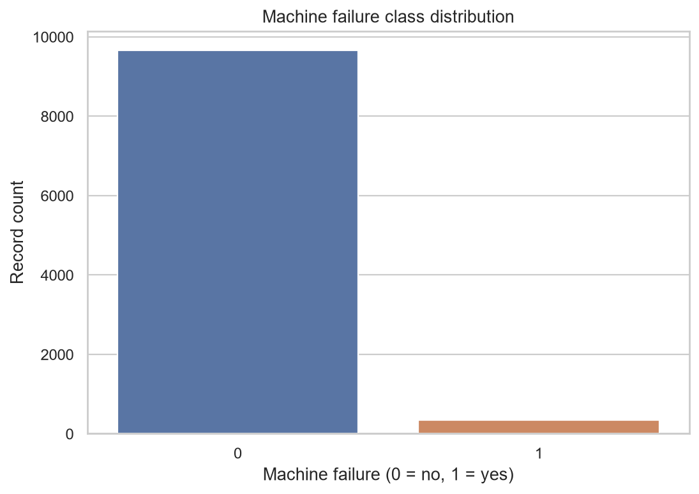
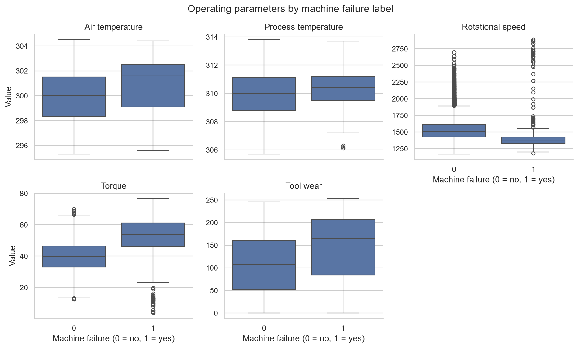
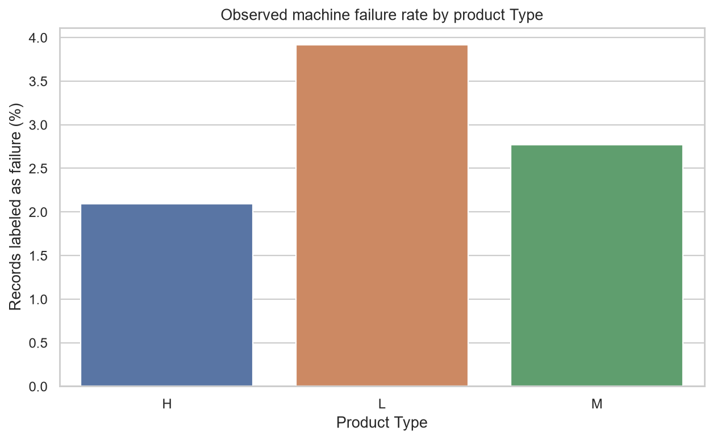
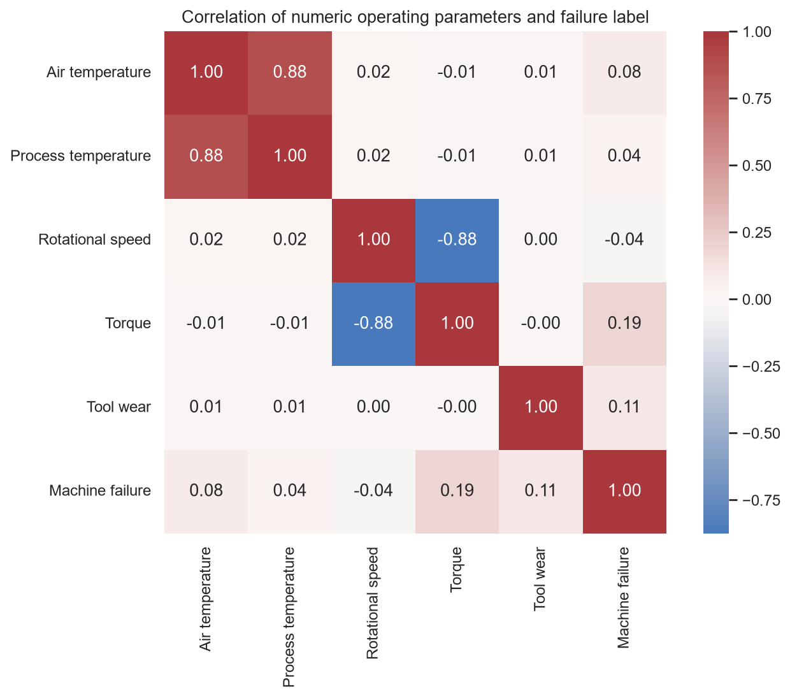

# Phase 2: Exploratory Data Analysis

## Dataset overview

- Source file: `data/raw/ai4i_2020_raw.csv` (original Phase 1 download; not modified).
- Shape: 10,000 rows by 14 columns.
- Missing cells: 0.
- Exact duplicate rows: 0.
- The identifier columns `UDI` and `Product ID` are present in this raw dataset. Their relevance will be addressed during preprocessing, not changed in this EDA phase.

## Target balance

| Machine failure label | Records | Share |
|---|---:|---:|
| 0 (no failure) | 9,661 | 96.61% |
| 1 (failure) | 339 | 3.39% |

The failure class is the minority class. Accuracy alone would therefore be a poor measure of whether a future classifier detects failures.

**What it shows:** the count difference between records labeled as failure and non-failure. It makes class imbalance visible; it is not a model result.

## Operating parameters

The table below compares descriptive statistics by the binary `Machine failure` label. These are associations in this dataset, not evidence that a parameter caused failure.

| Parameter           |   No-failure mean |   Failure mean |   No-failure median |   Failure median |
|:--------------------|------------------:|---------------:|--------------------:|-----------------:|
| Air temperature     |            299.97 |         300.89 |               300   |            301.6 |
| Process temperature |            310    |         310.29 |               310   |            310.4 |
| Rotational speed    |           1540.26 |        1496.49 |              1507   |           1365   |
| Torque              |             39.63 |          50.17 |                39.9 |             53.7 |
| Tool wear           |            106.69 |         143.78 |               107   |            165   |

**What it shows:** each box plot compares the distribution of one operating parameter for records labeled no-failure and failure. Different vertical scales are used so each parameter's spread can be seen. Overlap between boxes indicates that a single parameter may not cleanly distinguish the classes.

## Product Type

| Type   |   sum |   count |   mean |
|:-------|------:|--------:|-------:|
| H      |    21 |    1003 |   2.09 |
| L      |   235 |    6000 |   3.92 |
| M      |    83 |    2997 |   2.77 |

**What it shows:** the share of records labeled as failure within each product Type. The rates are descriptive and may be affected by sample counts; they do not establish that Type causes failure.

## Numeric correlations

|                     |   Correlation with Machine failure |
|:--------------------|-----------------------------------:|
| Torque              |                             0.1913 |
| Tool wear           |                             0.1054 |
| Air temperature     |                             0.0826 |
| Process temperature |                             0.0359 |
| Rotational speed    |                            -0.0442 |

**What it shows:** pairwise linear correlations among numeric operating parameters and the binary failure label. Correlation is not causation, and a weak linear correlation does not rule out nonlinear or interacting predictive patterns.

## Failure mode labels

The raw dataset includes the following failure mode label counts: `{'TWF': 46, 'HDF': 115, 'PWF': 95, 'OSF': 98, 'RNF': 19}`. These labels describe failure types; they must not be used as input features when predicting `Machine failure`, because that would leak outcome information.

## Findings

1. The dataset contains 10,000 records and 14 columns; this analysis left the source CSV unchanged.
2. There are 0 missing cells and 0 exact duplicate rows in the loaded data.
3. 3.39% of records are labeled as machine failures (339 of 10,000), confirming substantial class imbalance.
4. The largest positive linear correlation among the measured numeric parameters is for `Torque` (0.191). This is a descriptive statistic, not a feature-selection decision or causal finding.
5. In later modeling, use `Machine failure` as the target and exclude identifiers and failure-mode labels from the predictor inputs. Assess failure-class recall and precision-recall performance alongside other metrics.

## Generated charts

- `figures/failure_class_distribution.png`
- `figures/parameters_by_failure.png`
- `figures/failure_rate_by_type.png`
- `figures/numeric_correlation_heatmap.png`
