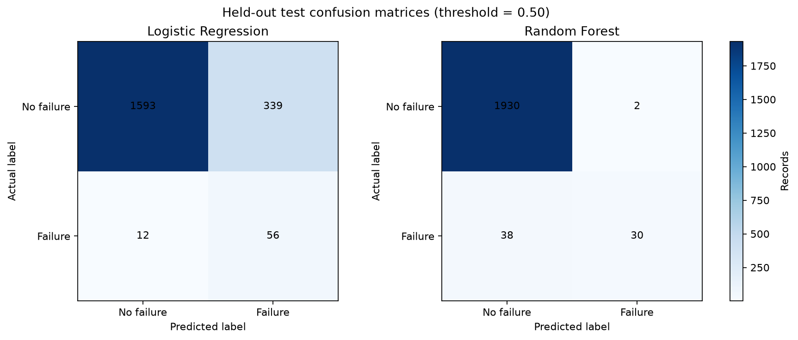
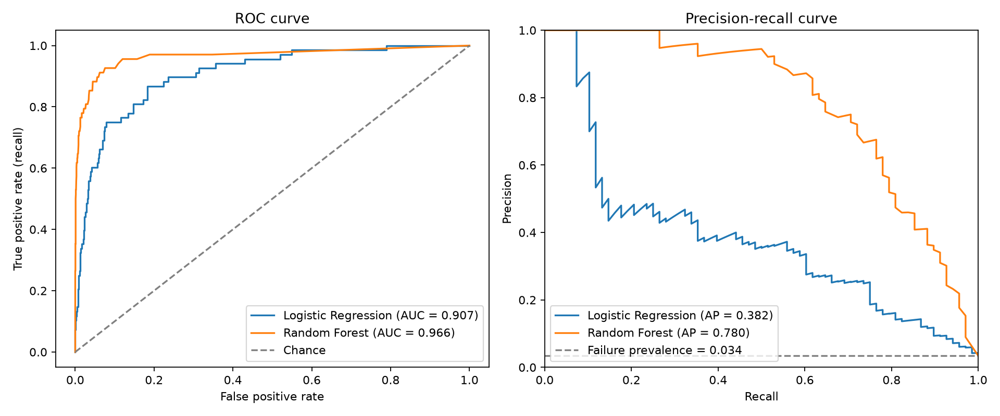

# Phase 4: Model Training and Evaluation

## Method

- Models: class-weighted Logistic Regression baseline and Random Forest.
- Selection criterion: mean 5-fold stratified cross-validation average precision on the training split only.
- Selected model: **Random Forest** (training CV average precision 0.7495).
- Both pipelines fit imputers, scaling, and one-hot encoding inside each CV fold, then refit on the complete training split.
- The held-out test split was evaluated once after model selection. No hyperparameter search or test-based threshold tuning was performed.
- Test decision threshold: 0.50. Class weights are used to address imbalance; their probability outputs should not be assumed calibrated.

## Model comparison

| model               |   cv_average_precision_mean |   cv_average_precision_std |   accuracy |   precision |   recall |     f1 |   roc_auc |   pr_auc_average_precision |
|:--------------------|----------------------------:|---------------------------:|-----------:|------------:|---------:|-------:|----------:|---------------------------:|
| Random Forest       |                      0.7495 |                     0.0328 |     0.98   |      0.9375 |   0.4412 | 0.6    |    0.9661 |                     0.7802 |
| Logistic Regression |                      0.4409 |                     0.0299 |     0.8245 |      0.1418 |   0.8235 | 0.2419 |    0.907  |                     0.3818 |

CV values are training-only. Test metrics use the untouched held-out split; positive-class recall and precision-recall average precision are important because failures are rare.

## Confusion matrices and error interpretation

### Logistic Regression

- True negatives: 1593
- False positives: 339 — healthy records flagged for follow-up, which can create unnecessary inspections.
- False negatives: 12 — failures missed by the model, which may be more consequential in a maintenance setting.
- True positives: 56

### Random Forest

- True negatives: 1930
- False positives: 2 — healthy records flagged for follow-up, which can create unnecessary inspections.
- False negatives: 38 — failures missed by the model, which may be more consequential in a maintenance setting.
- True positives: 30

## Ranking curves

ROC-AUC measures ranking across thresholds; average precision summarizes the precision-recall curve and is more informative than accuracy for a rare positive class. The chosen default threshold is not a deployment recommendation.

## Artifacts

- `artifacts/best_model.joblib`: selected fitted preprocessing-plus-classifier pipeline.
- `artifacts/training_summary.json`: CV scores, held-out metrics, confusion counts, selection criterion, and versions.
- `reports/phase4_model_comparison.csv`: CV and held-out metric comparison.

This is an educational prototype on a public dataset, not a validated industrial safety system.
